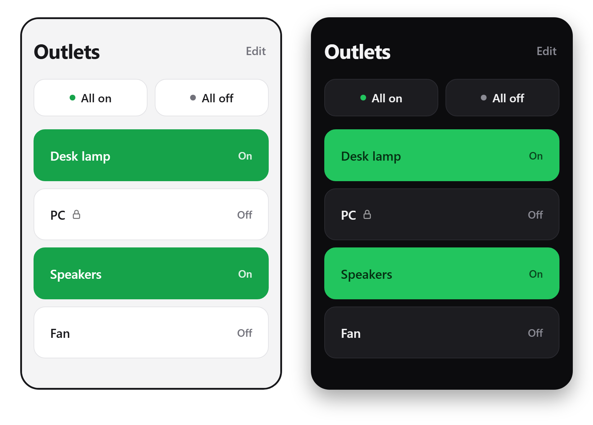

<div align="center">


# PureSwitch

Switch your Smart Life outlets with one tap. Nothing else.

The Smart Life app has become a bloated mess, with ads and AI, and it wants to be more than it is. It's slow and annoying. This is just an on/off switch on your phone. That's it.

[**Download PureSwitch.apk**](https://github.com/OlfJD/PureSwitch/releases/latest/download/PureSwitch.apk)

<br>



</div>

## How it works

- **Tap an outlet** to switch it. Green means on.
- **Edit → + Add outlet → Connect Smart Life** adds all your outlets at once. Enter your user code (in Smart Life: *Me → ⚙ → Account and Security → User Code*), then scan the code PureSwitch shows with Smart Life (*+ → Scan*). Only one phone? Take a screenshot of the code and pick it in Smart Life's scanner.
- **All on / All off** switch everything. *All on* goes one outlet at a time, so devices like a PC don't all draw their start-up current at once.
- **Ask before turning off**, in an outlet's settings, protects things that shouldn't lose power by accident.

Switching goes straight from your phone to the outlet over your Wi-Fi, not through Tuya's servers, so it also works when the internet is down. Smart Life is only needed once, to fetch each outlet's key.

## Requirements

Android 7 or newer, and Wi-Fi plugs, power strips or switches that you use with Smart Life or Tuya Smart (Tuya protocol 3.3 to 3.5, which covers nearly all current ones). Your phone has to be on the same Wi-Fi as the outlets. Play Protect may warn because the app isn't from the Play Store; choose *Install anyway*.

## Privacy

- No account, no ads, no tracking. Outlet keys are encrypted with the phone's hardware keystore and left out of phone backups. A diagnostics log of the last two days stays on the phone and is never sent anywhere.
- Only a device that proves it has an outlet's key gets commands, so a fake device on your Wi-Fi can't take over an outlet.
- *Connect Smart Life* is the only time PureSwitch goes online. Tuya offers this login only to Home Assistant, so PureSwitch uses Home Assistant's public login ID and Smart Life shows the request as Home Assistant. PureSwitch isn't affiliated with Tuya or Home Assistant. If Tuya ever blocks it, outlets you already added keep working, and *Import key file* takes keys from [tinytuya](https://github.com/jasonacox/tinytuya) instead.
- Older outlets (protocol 3.3) can't tell a replayed command from a new one. Replaying needs someone who can see your Wi-Fi traffic, which other devices on a normal home Wi-Fi can't.

## Building

```bash
npm install
npm run android
```

`npm run dev` runs a demo in the browser. Building without Android Studio and releasing are in [docs/BUILDING.md](docs/BUILDING.md), development notes in [DEVLOG.md](DEVLOG.md). MIT licensed; see [THIRD_PARTY_NOTICES.md](THIRD_PARTY_NOTICES.md).
