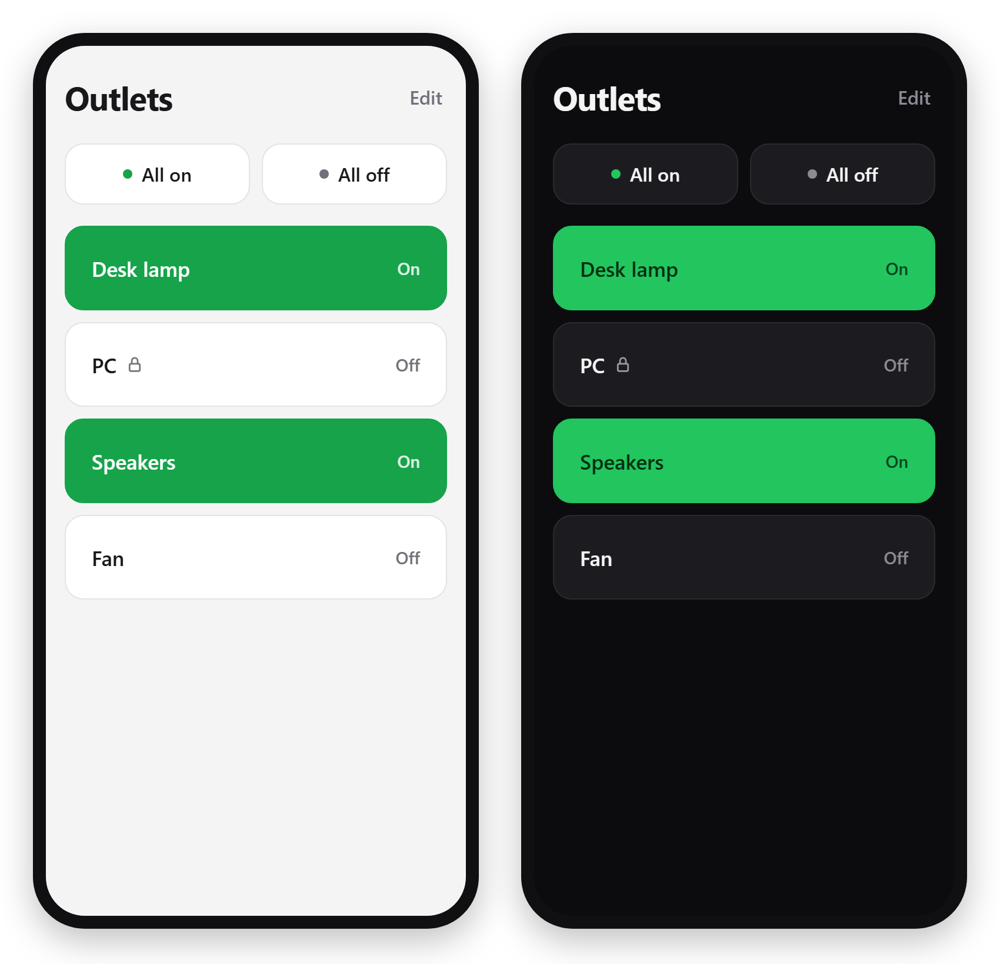
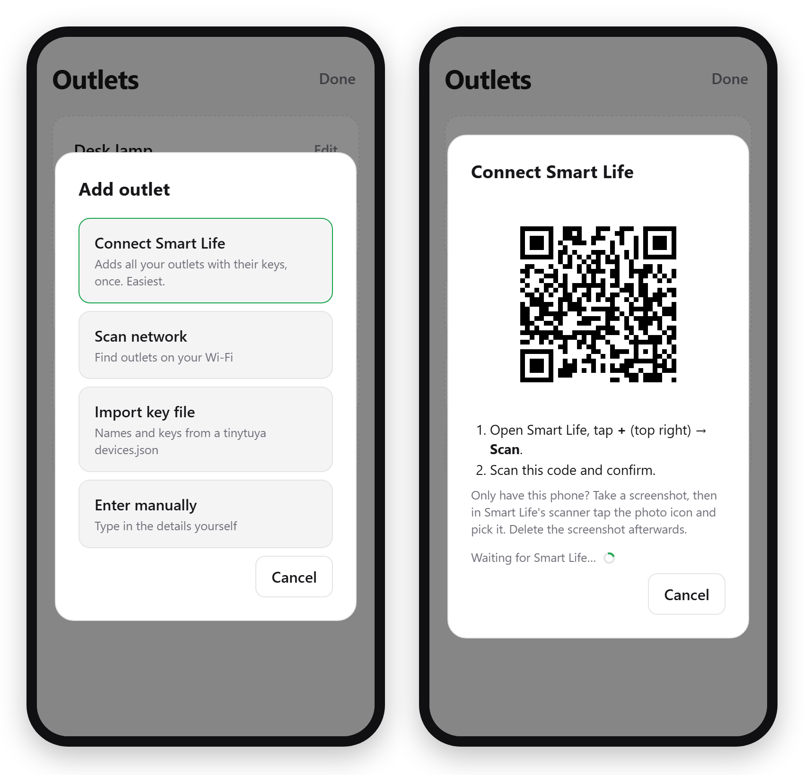

# PureSwitch

Switch your smart outlets on and off. Nothing else.\
A tiny, open-source alternative to the Smart Life app for Tuya outlets: one tap per outlet, straight over your Wi-Fi. No ads, no feeds, no cloud for switching.

**[Download for Android (.apk)](https://github.com/OlfJD/PureSwitch/releases/latest/download/PureSwitch.apk)**. Open the file on your phone and allow installing from your browser when Android asks. Play Protect may warn because the app isn't from the Play Store; choose *Install anyway*. Android 7 or newer.



## Features

- **One tap**: the whole app is a list of your outlets. Tap one to switch it. Green means on.
- **Straight over your Wi-Fi**: commands go from your phone to the outlet in your home network, not through Tuya's servers. Switching works even when your internet is down.
- **Set up in a minute**: *Connect Smart Life* adds all your outlets with their names at once. You only use Smart Life for that.
- **All on / All off**: *All on* switches outlets one after another, so devices like a PC don't all draw their start-up current at the same moment.
- **Ask before turning off**: lock an outlet (a PC, a 3D printer) and PureSwitch asks before cutting its power.
- **Finds your outlets** on the Wi-Fi by itself after setup. If your router gives one a new address, *Scan network* picks it up.
- **Light and dark**, following your phone.

## Setup

1. In PureSwitch tap **Edit → + Add outlet → Connect Smart Life**.
2. Enter your **user code**. In Smart Life it's under *Me → ⚙ → Account and Security → User Code*.
3. In Smart Life tap **+ → Scan**, scan the code PureSwitch shows and confirm. Only one phone? Take a screenshot of the code and pick it in Smart Life's scanner with the photo icon.

PureSwitch adds your plugs, power strips and switches (lights, cameras etc. are left out) and finds them on your Wi-Fi. Your phone has to be on the same Wi-Fi as the outlets to switch them.



<details>
<summary>Why does it need Smart Life at all?</summary>

Tuya outlets only accept commands that are encrypted with their own secret key. They never send that key over Wi-Fi, and only Tuya's cloud knows it, because it gave the key to the outlet when you paired it in Smart Life. So PureSwitch fetches the keys once: it signs in, copies the keys into your phone's encrypted storage, and signs out again. From then on it never contacts Tuya.

Run *Connect Smart Life* again only after you add a new outlet or pair one again in Smart Life (that gives it a new key).

**Good to know:** Tuya offers this QR login only to Home Assistant, so PureSwitch uses Home Assistant's public login ID, and Smart Life shows the request as coming from Home Assistant. PureSwitch is not made by or affiliated with Home Assistant or Tuya. If Tuya ever blocks this, switching keeps working for outlets you already added; for new outlets you can import keys with [tinytuya](https://github.com/jasonacox/tinytuya) instead (*Import key file*).

</details>

## Which outlets work?

Wi-Fi plugs, power strips and switches that you control with **Smart Life** or **Tuya Smart**, from many brands (Tuya protocol 3.3, 3.4 and 3.5, which covers nearly all current ones). Outlets that use their own app instead, like Shelly, TP-Link Kasa or FRITZ!DECT, don't work with PureSwitch.

## Privacy and security

- **Everything stays on your phone.** No account in PureSwitch, no tracking, no ads. Your outlets' keys are encrypted with the phone's hardware keystore and left out of phone backups.
- **Switching only ever talks to your home network.** The one-time Smart Life login is the only internet connection PureSwitch makes, and only to Tuya.
- **Fake devices can't take over an outlet.** Anyone on your Wi-Fi could pretend to be one of your outlets. PureSwitch only sends commands to a device that proves it has the outlet's key.
- **One limit of older outlets:** outlets with protocol 3.3 encrypt in a simple way, so someone who can see the traffic between your phone and the outlet could replay a recorded command. On a normal home Wi-Fi other devices can't see that traffic. Newer outlets (3.4 and 3.5) aren't affected.

## Build

```bash
git clone https://github.com/OlfJD/PureSwitch.git
cd PureSwitch
npm install
npm run dev        # demo mode in the browser
npm run android    # Android app, opens Android Studio
```

Needs Node.js and Android Studio (or JDK 21 and the Android SDK). [docs/BUILDING.md](docs/BUILDING.md) covers building without Android Studio and releasing. `DEVLOG.md` has the changelog and design decisions.

## License

MIT. Not affiliated with Tuya, Smart Life or Home Assistant. The Smart Life login is ported from Tuya's MIT-licensed SDK; see [THIRD_PARTY_NOTICES.md](THIRD_PARTY_NOTICES.md).
